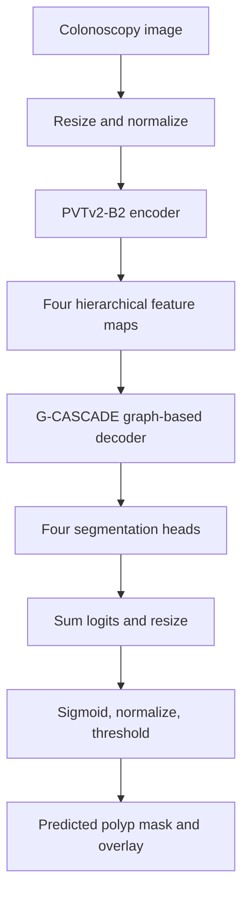

# G-CASCADE ? EN3160 Computer Vision Reproduction

A practical reproduction of **G-CASCADE: Efficient Cascaded Graph
Convolutional Decoding for 2D Medical Image Segmentation** (WACV 2024).

This project focuses on **binary polyp segmentation** using the
**PVTv2-B2 encoder** and **G-CASCADE decoder with additive skip aggregation**.

> **Reproduction status:** Training voluntarily stopped after
> 90 of 199 planned completed epochs. The best validation
> checkpoint was obtained at epoch 19. The saved model supports
> live inference, mask visualization and reproducible evaluation.
> This is a partial reproduction, not a completed 199-epoch run.

## Reproduced results

The following values are from the selected best model,
evaluated on the same four datasets used for checkpoint selection.

| Dataset | Images | Dice | IoU |
|---|---:|---:|---:|
| CVC-ClinicDB | 62 | 0.928477 | 0.880758 |
| Kvasir | 100 | 0.916251 | 0.864641 |
| CVC-ColonDB | 380 | 0.811656 | 0.729943 |
| CVC-300 | 60 | 0.897185 | 0.831153 |
| **Image-count-weighted** | **602** | **0.849587** | **See evaluation report** |

**Important:** These are validation metrics from data used
to select the best checkpoint. They are not independent
held-out test performance estimates.

Detailed metrics:
[Evaluation results](results/baseline/final_evaluation_summary.csv)

## Architecture and inference pipeline

The architecture image from the original research repository
is preserved in the original documentation below.



## Experiment configuration

| Setting | Reproduced setup |
|---|---|
| Encoder | PVTv2-B2 |
| Decoder | G-CASCADE, additive aggregation |
| Input image size | 352 ? 352 |
| Batch size | 4 |
| Optimizer | AdamW |
| Learning rate | 0.0001 |
| Weight decay | 0.0001 |
| Completed training | 90 / 199 epochs |
| Best checkpoint | Epoch 19 |
| Best weighted validation Dice | 0.849586710963455 |
| Resume checkpoint | Epoch 90 |

The best weights, datasets and large resumable checkpoints
are kept locally and are not committed to ordinary Git.

[Training progress](docs/training_progress.md) ?
[Baseline workflow](docs/baseline_workflow.md)

## Run the live polyp segmentation demo

On the prepared Windows machine, activate the existing
`gcascade` Conda environment and open the repository root.

The local best-model file is:

`experiments/official_run03/models/Polyp_PVT_GCASCADE_img_size352bs4_Run3-best.pth`

Run:

```powershell
conda activate gcascade

python -m scripts.demo_polyp `
    --checkpoint .\experiments\official_run03\models\Polyp_PVT_GCASCADE_img_size352bs4_Run3-best.pth `
    --device cuda `
    --test-size 352
```

Choose an endoscopy image from the file picker.

To show **ground truth and per-image Dice/IoU**, also provide
the corresponding image and mask paths:

```powershell
python -m scripts.demo_polyp `
    --checkpoint .\experiments\official_run03\models\Polyp_PVT_GCASCADE_img_size352bs4_Run3-best.pth `
    --image .\data\polyp\TestDataset\CVC-ClinicDB\images\100.png `
    --ground-truth .\data\polyp\TestDataset\CVC-ClinicDB\masks\100.png `
    --device cuda `
    --test-size 352
```

The viewer displays input, evaluated input, predicted mask,
red prediction overlay and ground truth.

### Generate a saved comparison image

Use the same command with an additional `--save-panel`
argument pointing to a new output file. The demo will
save the comparison panel rather than opening a window.

The verified local demonstration panel is at:

`experiments/official_run03/final_demo_evaluation/demo_comparison.png`

This generated example is kept locally pending confirmation
that the underlying dataset image may be redistributed.

## Reproduce validation evaluation

Ensure the original polyp datasets and the best-model
checkpoint are available locally. From the repository root:

```powershell
python -m scripts.evaluate_polyp `
    --checkpoint .\experiments\official_run03\models\Polyp_PVT_GCASCADE_img_size352bs4_Run3-best.pth `
    --dataset-root .\data\polyp\TestDataset `
    --output .\experiments\official_run03\recheck_evaluation `
    --device cuda `
    --test-size 352 `
    --export-masks
```

Choose a new empty output directory for every evaluation.

The script generates dataset summaries, per-image Dice/IoU,
evaluation metadata and optional predicted mask images.

## Code structure

| File | Role |
|---|---|
| `train_polyp.py` | Training, structure loss, validation |
| `lib/networks.py` | PVT-GCASCADE network |
| `lib/decoders.py` | Decoder building blocks |
| `scripts/demo_polyp.py` | Interactive segmentation viewer |
| `scripts/evaluate_polyp.py` | Reproducible evaluation |
| `utils/polyp_evaluation.py` | Inference and metric utilities |
| `scripts/run_polyp_session.ps1` | Resumable five-epoch sessions |
| `docs/final_demo.md` | Demo and evaluation instructions |

The locally verified evaluation covers 602 images. The
reproduction achieved a best image-count-weighted validation
Dice of **0.849587**. No claim is made that it matches
the original paper's complete experimental protocol.

## Original research and attribution

This repository is a fork of
[SLDGroup/G-CASCADE](https://github.com/SLDGroup/G-CASCADE).

Original paper: **Md Mostafijur Rahman and Radu Marculescu,
G-CASCADE: Efficient Cascaded Graph Convolutional Decoding
for 2D Medical Image Segmentation, WACV 2024.**

The original README, installation instructions, architecture
image, acknowledgements and citation follow below.

---

# Original G-CASCADE README

# G-CASCADE

Official Pytorch implementation of [G-CASCADE: Efficient Cascaded Graph Convolutional Decoding for 2D Medical Image Segmentation](https://openaccess.thecvf.com/content/WACV2024/html/Rahman_G-CASCADE_Efficient_Cascaded_Graph_Convolutional_Decoding_for_2D_Medical_Image_WACV_2024_paper.html) WACV 2024. [arxiv](https://arxiv.org/abs/2310.16175) [code](https://github.com/SLDGroup/G-CASCADE) 
 <br>
[Md Mostafijur Rahman](https://github.com/mostafij-rahman), [Radu Marculescu](https://radum.ece.utexas.edu/)
<p>The University of Texas at Austin</p>

### 🔍 **Check out our CVPR 2024 paper! [EMCAD](https://github.com/SLDGroup/EMCAD)** 
### 🔍 **Check out our CVPRW 2024 paper! [PP-SAM](https://github.com/SLDGroup/PP-SAM)** 
### 🔍 **Check out our MIDL 2023 paper! [MERIT](https://github.com/SLDGroup/MERIT)** 
### 🔍 **Check out our WACV 2023 paper! [CASCADE](https://github.com/SLDGroup/CASCADE)** 

## Architecture

<p align="center">

</p>

## Qualitative Results

<p align="center">

</p>

## Usage:
### Recommended environment:
```
Python 3.8
Pytorch 1.11.0
torchvision 0.12.0
```
Please use ```pip install -r requirements.txt``` to install the dependencies.

### Data preparation:
- **Synapse Multi-organ dataset:**
Sign up in the [official Synapse website](https://www.synapse.org/#!Synapse:syn3193805/wiki/89480) and download the dataset. Then split the 'RawData' folder into 'TrainSet' (18 scans) and 'TestSet' (12 scans) following the [TransUNet's](https://github.com/Beckschen/TransUNet/blob/main/datasets/README.md) lists and put in the './data/synapse/Abdomen/RawData/' folder. Finally, preprocess using ```python ./utils/preprocess_synapse_data.py``` or download the [preprocessed data](https://drive.google.com/file/d/1wvmw8DVyDKr5sOAFn5zUpfhbK4Vxjze4/view) and save in the './data/synapse/' folder. 
Note: If you use the preprocessed data from [TransUNet](https://drive.google.com/drive/folders/1ACJEoTp-uqfFJ73qS3eUObQh52nGuzCd), please make necessary changes (i.e., remove the code segment (line# 88-94) to convert groundtruth labels from 14 to 9 classes) in the utils/dataset_synapse.py. 

- **ACDC dataset:**
Download the preprocessed ACDC dataset from [Google Drive](https://drive.google.com/file/d/1CruCQ-jjvA97BX-LIYwXaRMLmp3DN9zc/view) and move into './data/ACDC/' folder.

- **Polyp datasets:**
Download the training and testing datasets [Google Drive](https://drive.google.com/file/d/1pFxb9NbM8mj_rlSawTlcXG1OdVGAbRQC/view?usp=sharing) and move them into './data/polyp/' folder.

- **ISIC2018 dataset:**
Download the training and validation datasets from https://challenge.isic-archive.com/landing/2018/ and merge them together. Afterwards, split the dataset into 80%, 10%, and 10% training, validation, and testing datasets, respectively. Move the splited dataset into './data/ISIC2018/' folder. 

### Pretrained model:
You should download the pretrained PVTv2 model from [Google Drive](https://drive.google.com/drive/folders/1d5F1VjEF1AtTkNO93JwVBBSivE8zImiF?usp=share), and then put it in the './pretrained_pth/pvt/' folder for initialization. Similarly, you should download the pretrained MaxViT models from [Google Drive](https://drive.google.com/drive/folders/1wuJ8zekQpPfmydqVhfO1LYSKxrik4Ukf?usp=share_link), and then put it in the './pretrained_pth/maxvit/' folder for initialization.

### Training:
```
cd into G-CASCADE
```

For Synapse Multi-organ dataset training, run ```CUDA_VISIBLE_DEVICES=0 python -W ignore train_synapse.py```

For ACDC dataset training, run ```CUDA_VISIBLE_DEVICES=0 python -W ignore train_ACDC.py```

For Polyp datasets training, run ```CUDA_VISIBLE_DEVICES=0 python -W ignore train_polyp.py```

For ISIC2018 dataset training, run ```CUDA_VISIBLE_DEVICES=0 python -W ignore train_ISIC2018.py```

### Testing:
```
cd into G-CASCADE 
```

For Synapse Multi-organ dataset testing, run ```CUDA_VISIBLE_DEVICES=0 python -W ignore test_synapse.py```

For ACDC dataset testing, run ```CUDA_VISIBLE_DEVICES=0 python -W ignore test_ACDC.py```

For Polyp dataset testing, run ```CUDA_VISIBLE_DEVICES=0 python -W ignore test_polyp.py```

For ISIC2018 dataset testing, run ```CUDA_VISIBLE_DEVICES=0 python -W ignore test_ISIC2018.py```

## Acknowledgement
We are very grateful for these excellent works [timm](https://github.com/huggingface/pytorch-image-models), [MERIT](https://github.com/SLDGroup/MERIT), [CASCADE](https://github.com/SLDGroup/CASCADE), [PraNet](https://github.com/DengPingFan/PraNet), [Polyp-PVT](https://github.com/DengPingFan/Polyp-PVT) and [TransUNet](https://github.com/Beckschen/TransUNet), which have provided the basis for our framework.

## Citations
```
@inproceedings{rahman2024g,
  title={G-CASCADE: Efficient Cascaded Graph Convolutional Decoding for 2D Medical Image Segmentation},
  author={Rahman, Md Mostafijur and Marculescu, Radu},
  booktitle={Proceedings of the IEEE/CVF Winter Conference on Applications of Computer Vision},
  pages={7728--7737},
  year={2024}
}
```
